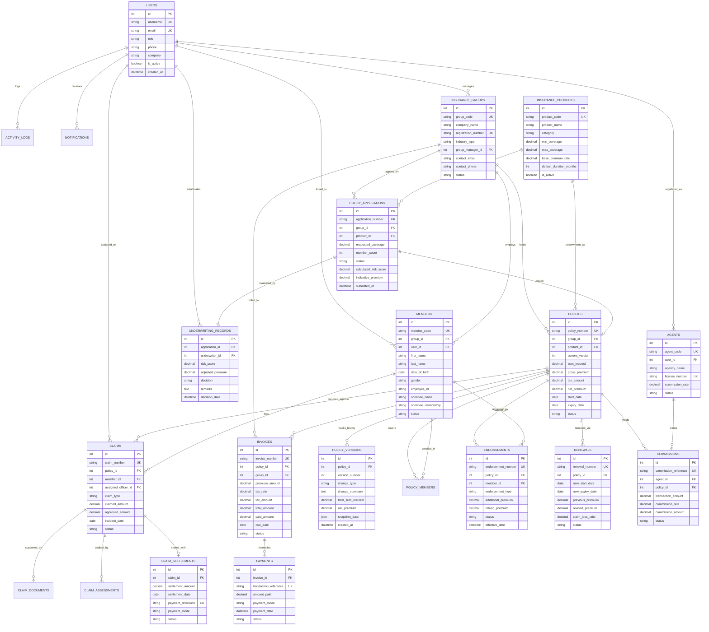

# InsureEase – Entity Relationship (ER) Diagram (P20)

## 1. High-Level Relational Architecture

The InsureEase database contains 22 normalized relational tables implemented in MySQL 8.0 (InnoDB engine, UTF8mb4 encoding) with full relational integrity, foreign key cascading or protect constraints, and targeted indexes on frequently queried search fields and state columns.

---

## 2. Mermaid Entity-Relationship Diagram

